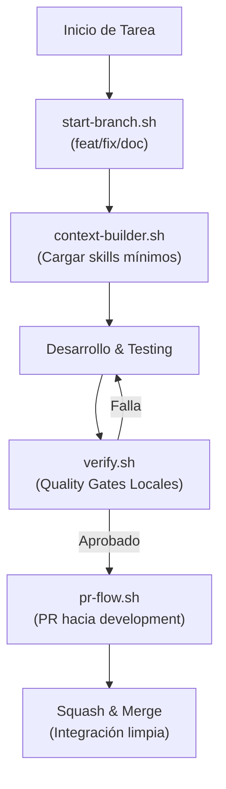

# 🔄 WORKFLOWS.md — Guía Maestra de Flujos Operativos

> **Antigravity Voice Assistant** · Protocolo de Trabajo, Ramas, Validación y Entrega Continua.

---

## 🧭 Visión General de Flujos de Trabajo



---

## 🌿 1. Flujo de Ramas (Branching Flow)

Toda tarea debe realizarse en una rama dedicada partiendo de `development`:

### Crear y Activar una Rama
Usa el script de automatización del proyecto:
```bash
# Iniciar una característica:
bash .agents/scripts/start-branch.sh feat "stt-voice-input"

# Iniciar una corrección de bug:
bash .agents/scripts/start-branch.sh fix "audio-pause-safari"

# Iniciar documentación:
bash .agents/scripts/start-branch.sh doc "update-roadmap-v2"
```

### Convenciones de Ramas
- `development`: Rama base de desarrollo e integración continua.
- `main`: Rama de producción estable.
- `feat/*`: Nuevas capacidades y características.
- `fix/*`: Correcciones de bugs y estabilidad.
- `doc/*`: Documentación técnica y guías de usuario.

---

## ⚡ 2. Flujo de Contexto Mínimo y Desarrollo

Para ahorrar tokens y mantener la agilidad del agente, selecciona solo el contexto necesario:

```bash
# Generar contexto mínimo según el tipo de tarea:
bash .agents/scripts/context-builder.sh feature   # Desarrollo de nuevas funciones
bash .agents/scripts/context-builder.sh bugfix    # Depuración de problemas
bash .agents/scripts/context-builder.sh qa        # Pruebas y validación
bash .agents/scripts/context-builder.sh docs      # Documentación técnica
bash .agents/scripts/context-builder.sh git       # Gestión de ramas y PRs

# Extraer una skill específica bajo demanda:
bash .agents/scripts/lazy-skill.sh accessible-voice-assistant
```

### Regla de Paridad Obligatoria
Al modificar el reproductor visual o la lógica de audio:
1. Actualizar `audio_assistant.html`.
2. Sincronizar las plantillas en `skills/accessible-voice-assistant/resources/audio-assistant-template.html` y `.agents/skills/...`.
3. Mantener el bloque `#raw-text-source` estructurado para accesibilidad.

---

## 🚦 3. Flujo de Quality Gates y Validación

Antes de registrar cualquier commit o abrir un Pull Request, es obligatorio ejecutar la suite local:

```bash
# 1. Validar todos los Quality Gates (manifiesto, Python CLI, HTML, YAML):
bash .agents/scripts/verify.sh

# 2. Auditar presupuesto de tokens:
bash .agents/scripts/token-audit.sh

# 3. Validar sintaxis y metadatos de skills:
bash .agents/scripts/skill-lint.sh
```

> [!IMPORTANT]
> Ningún código debe confirmarse en git si `verify.sh` no concluye con código de salida `0`.

---

## 🚀 4. Flujo de Pull Requests y Entrega (PR Flow)

Automatiza la creación y gestión del Pull Request hacia `development`:

```bash
# Flujo interactivo completo de PR con validación previa:
bash .agents/scripts/pr-flow.sh "feat(stt): voice input and hands-free commands" "Implementa reconocimiento de voz y comandos manos libres."

# Crear PR sin hacer merge inmediato:
bash .agents/scripts/pr-flow.sh "fix(audio): fix pause bug" "Detalle del fix" --no-merge
```

### Estrategia de Merge Recomendada
- **Squash and Merge**: Condensa los commits de la rama en un único commit atómico y limpio en `development`.
- Al finalizar el merge, eliminar la rama local y remota para mantener el repositorio ordenado.

---

## 🛠️ 5. Matriz Rápida de Comandos

| Tarea | Comando Recomendado |
| :--- | :--- |
| Iniciar rama | `bash .agents/scripts/start-branch.sh <tipo> <nombre>` |
| Contexto mínimo | `bash .agents/scripts/context-builder.sh <tarea>` |
| Quality Gates | `bash .agents/scripts/verify.sh` |
| Auditoría de tokens | `bash .agents/scripts/token-audit.sh` |
| Linting de skills | `bash .agents/scripts/skill-lint.sh` |
| Crear y fusionar PR | `bash .agents/scripts/pr-flow.sh "<título>" "<descripción>"` |
| Menú de workflows CI | `bash .agents/scripts/runner-menu.sh` |
