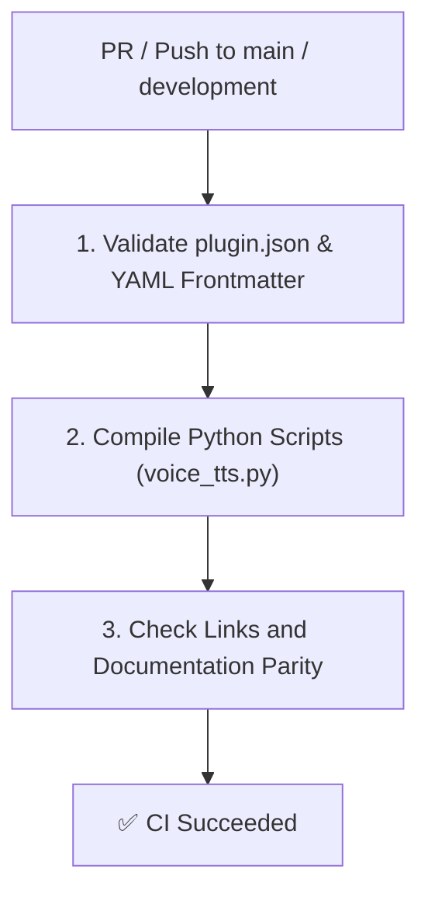

# CI Manager Skill — Antigravity Voice Assistant 🎙️

This skill governs, optimizes, and audits Continuous Integration (CI) workflows for **Antigravity Voice Assistant**, ensuring multi-platform compatibility (Linux, macOS, Windows) and automated validation.

---

## 🎯 CI Scope & Responsibilities

1. **Manifest & Asset Integrity:**
   - Validates `plugin.json` schema on every PR and push.
   - Ensures all templates and HTML embeds have valid syntax and relative file references.
2. **Cross-Platform Script Testing:**
   - Verifies `scripts/voice_tts.py` runs cleanly under Linux (Python 3.8+), macOS, and Windows.
3. **Documentation Parity Check:**
   - Validates that new features added to templates are reflected in `README.md` and `SKILL.md`.

---

## 🏗️ Typical CI Workflow Pipeline

