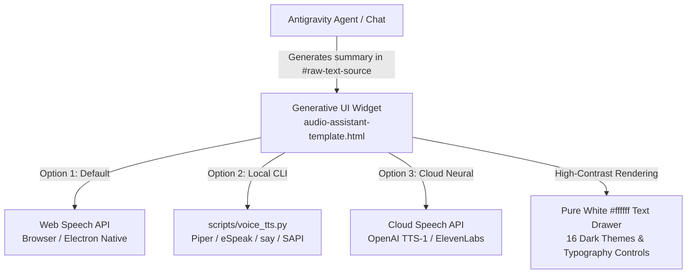

# Architecture & Technical Design

This document details the internal design and technical components of the **Accessible Voice Assistant for Antigravity**.

---

## 🏗️ High-Level Overview

The plugin bridges the Antigravity conversational AI workflow with accessible auditory and high-contrast visual presentations. It is structured into three main layers:

---

## 🧩 Core Components

### 1. Plugin Manifest ([`plugin.json`](file:///home/fernando/antigravity-voice-assistant/plugin.json))
- Defines metadata, package name (`accessible-voice-assistant`), version (`1.1.0`), author, and default suggested prompts.
- Registers the package with the Antigravity plugin loader for global discovery under `~/.gemini/config/plugins/` or workspace-level activation.

### 2. Behavioral Rules ([`rules/AGENTS.md`](file:///home/fernando/antigravity-voice-assistant/rules/AGENTS.md))
- Automatically instructs the active agent to generate the audio artifact `<appDataDir>/brain/<conversation-id>/audio_assistant.html` and embed it at the very top of each response using `<agent-embed>`.
- Enforces typography standards: large headings (`##`), bold callouts, concise bullet points, and high-contrast color codes (`#0b1120` canvas, `#ffffff` text, `#38bdf8` borders, `#facc15` focus highlights).

### 3. Skill & UI Template ([`skills/accessible-voice-assistant/`](file:///home/fernando/antigravity-voice-assistant/skills/accessible-voice-assistant/SKILL.md))
- **`SKILL.md`**: Provides agent operational knowledge, embedding guidelines, and feature switches.
- **`audio-assistant-template.html`**: Self-contained single-file HTML/JS/CSS widget built with DaisyUI & Tailwind CSS (inlined/CDN). Key capabilities:
  - Markdown-to-speech parsing (strips URLs and unpronounceable characters, structures lists and headings into human-like cadences).
  - Multi-engine dispatcher (Web Speech API, Local CLI bridge, Cloud Neural endpoints).
  - Theme manager with 16 palettes, background opacity slider (`25%` - `100%`), and font scaling (`14px` - `36px`).
  - Persistent state in `localStorage` for volume, rate, theme, language, and display preferences.

### 4. Local CLI Bridge ([`scripts/voice_tts.py`](file:///home/fernando/antigravity-voice-assistant/scripts/voice_tts.py))
- Cross-platform Python script providing command-line text-to-speech fallback:
  - **Linux**: Prioritizes `piper` neural TTS, falls back to `spd-say`, `espeak-ng`, or `espeak`.
  - **macOS**: Uses native `say` with speech rate calculation.
  - **Windows**: Invokes PowerShell `System.Speech.Synthesis.SpeechSynthesizer`.
- Accepts parameters `--rate`, `--voice`, and `--engine`. Reads from command-line arguments or `sys.stdin`.

---

## 🔊 Speech Parsing & Cadence

To ensure clarity for low-vision users, text is not fed raw into the speech synthesizer. It undergoes structured cadence formatting:
- **Headings (`## Title`)**: Announced with contextual emphasis ("Section: Title").
- **Bullet Items (`* item`, `- item`)**: Preceded by natural pauses and markers ("Option: item").
- **Numbered Steps (`1. step`)**: Preceded by step indicators ("Step 1: step").
- **Links (`[Label](url)`)**: Cleaned to speak only the human-readable label and pause before navigating.
- **Code Blocks**: Formatted to announce code sections concisely rather than reading punctuation verbatim.
