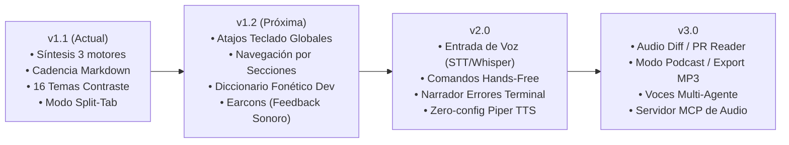

# 🗺️ Roadmap del Asistente de Voz Accesible para Antigravity

Este documento describe la visión, etapas de desarrollo y características planificadas para el **Accessible Voice Assistant for Antigravity**.

El objetivo principal es proporcionar una experiencia de desarrollo inclusiva, fluida y altamente eficiente para desarrolladores con **baja visión**, ceguera o preferencia por flujos de trabajo basados en audio y temas de alto contraste.

---

## 🧭 Visión General de Versiones

---

## 📌 Detalle de Fases y Características

### 🚀 Fase 1: v1.2 — Ergonomía, Atajos y Navegación Auditiva (Completada ✔)
*Enfocada en control 100% por teclado, navegación granular del audio y pronunciación técnica precisa.*

- [x] **Atajos de Teclado Globales (Keyboard Hotkeys)**:
  - Operar el asistente sin retirar las manos del código ni requerir puntero:
    - `Space` / `Ctrl+Alt+Space`: Reproducir / Pausar.
    - `Ctrl+Alt+R`: Reiniciar desde el inicio.
    - `Ctrl+Alt+S`: Detener reproducción.
    - `Ctrl+Alt+↑` / `Ctrl+Alt+↓`: Aumentar / Disminuir velocidad de reproducción (`0.1x`).
    - `Ctrl+Alt+M`: Silenciar / Desilenciar audio.
- [x] **Navegación por Secciones (Audio Scrubbing & Section Jumping)**:
  - Capacidad de saltar directamente al siguiente encabezado (`##`), sección de pasos numerados o lista de viñetas.
  - Botones dedicados `⏮` y `⏭` en la botonera multimedia.
  - Salto inteligente de bloques de código densos para mantener la agilidad de escucha.
- [x] **Diccionario Fonético para Código (Tech Pronunciation Lexicon)**:
  - Reglas de pronunciación fonética para acrónimos y convenciones de programación:
    - `JSON` ➔ *"yeison"*.
    - `async/await` ➔ *"eisinck y e-güeit"*.
    - `regex` ➔ *"reg-ex"*.
    - `API`, `CLI`, `SQL`, `kubectl`, `GraphQL`, `UUID`, `OAuth`, `JWT`.
    - Operadores matemáticos y lógicos (`===`, `!==`, `!=`, `==`, `=>`, `->`, `&&`, `||`).
- [x] **Earcons (Señales Sonoras de Sistema con Web Audio API)**:
  - Notificaciones acústicas breves y de frecuencia suave al:
    - Iniciar reproducción auditiva (chime ascendente).
    - Concluir o detener reproducción (chime descendente).

---

### 🎙️ Fase 2: v2.0 — Entrada de Voz (STT) y Control Hands-Free (Completada ✔)
*Transformar el asistente en una herramienta bidireccional: habla y escucha.*

- [x] **Dictado por Voz para Prompts (Speech-to-Text)**:
  - Botón de micrófono reactivo en la barra superior con indicador visual de pulso y atajo global <kbd>Ctrl+Alt+D</kbd>.
  - Panel desplegable `dictation-drawer` con transcripción en tiempo real y botón de un clic para copiar al portapapeles.
  - Soporte CLI multiplataforma con [`scripts/voice_stt.py`](file:///home/fernando/antigravity-voice-assistant/scripts/voice_stt.py) (captura con `arecord`/`sox`/`ffmpeg` y transcripción Whisper).
- [x] **Comandos de Voz Hands-Free (Voice Action Triggers)**:
  - Control por voz sin tocar teclado ni ratón:
    - *"Pausar"* / *"Detener"* -> Pausa la síntesis auditiva.
    - *"Continuar"* / *"Reanudar"* -> Reanuda la lectura.
    - *"Siguiente"* / *"Avanza"* -> Salta a la siguiente sección.
    - *"Anterior"* / *"Regresa"* -> Regresa a la sección previa.
    - *"Reiniciar"* -> Vuelve a la primera sección.
    - *"Más rápido"* / *"Más lento"* -> Ajusta la velocidad dinámicamente.
    - *"Silencio"* -> Silencia o restaura el volumen.
  - Feedback acústico con "Earcons" especializados para activación de micrófono y confirmación de comando.
- [x] **Empaquetado Zero-Config de Piper TTS Local**:
  - Script gestor [`scripts/setup_piper.py`](file:///home/fernando/antigravity-voice-assistant/scripts/setup_piper.py) para descargar y configurar modelos neuronales compactos de Piper TTS en español e inglés sin requerir configuración manual ni claves de API de pago.
- [ ] **Detección Opcional de Palabra de Activación (Wake-Word)**:
  - Activación por voz con palabras clave (*"Oye Asistente"* o *"Hey Antigravity"*).

---

### 💻 Fase 3: v2.5 — Asistencia en Flujo de Desarrollo (Audio IDE) (Completada ✔)
*Integración directa con la terminal, git y el código en edición.*

- [x] **Narrador de Errores de Terminal & Fallos en Pruebas**:
  - Wrapper CLI inteligente [`scripts/voice_notify.py`](file:///home/fernando/antigravity-voice-assistant/scripts/voice_notify.py) para ejecutar cualquier comando de pruebas o build (`pytest`, `npm test`, `verify.sh`).
  - Extracción automática de excepciones (`AssertionError`, `ValueError`, `SyntaxError`, etc.) y anuncio verbal conciso del error principal sin tener que leer tracebacks kilométricos.
- [x] **Audio Diff & Reviewer de Git**:
  - Comando `python3 scripts/voice_notify.py --git-diff` para narrar el estado del repositorio antes de un commit: número de archivos modificados, líneas agregadas/eliminadas y lista de archivos clave.
- [x] **Resumen Semántico de Código para Audio**:
  - Detección y condensación de bloques de código en sintaxis natural para evitar escuchar ruido sintáctico repetitivo.

---

### 🌐 Fase 4: v3.0 — Ecosistema, Exportación y Multi-Agente (En progreso / v3.0 ✔)
*Fidelidad acústica y colaboración avanzada con el ecosistema Antigravity.*

- [x] **Exportación de Audio / "Modo Podcast"**:
  - Herramienta [`scripts/voice_podcast.py`](file:///home/fernando/antigravity-voice-assistant/scripts/voice_podcast.py) para generar y descargar archivos de audio estructurados por capítulos a partir de explicaciones técnicas largas o documentos Markdown.
- [x] **Servidor MCP de Voz (Model Context Protocol)**:
  - Servidor JSON-RPC estándar [`scripts/mcp_voice_server.py`](file:///home/fernando/antigravity-voice-assistant/scripts/mcp_voice_server.py) exponiendo herramientas `speak_text`, `narrate_error`, `export_podcast` y `get_status` para agentes externos en Antigravity.
- [x] **Servidor Web Seguro Local**:
  - Servidor background [`scripts/voice_server.py`](file:///home/fernando/antigravity-voice-assistant/scripts/voice_server.py) en `http://localhost:54321` para habilitar Web Speech API con contexto seguro en Chromium y navegadores modernos.
- [ ] **Diferenciación de Voces Multi-Agente**:
  - Asignación de timbres o personalidades de voz distintas para agentes especializados (ej. voz sobria para el auditor de seguridad, voz enérgica para el optimizador).
- [ ] **Widget Permanente en Barra de Estado (Status Bar Pill)**:
  - Mini-control en la barra de estado de Antigravity para pausar/reanudar y ver el progreso sin ocupar espacio en el editor.

---

## 📊 Matriz de Priorización e Impacto

| Característica | Impacto en Accesibilidad | Complejidad Técnica | Versión Objetivo |
| :--- | :---: | :---: | :---: |
| **Atajos de Teclado Globales** | 🔴 Alto | 🟢 Baja | **v1.2** |
| **Diccionario Fonético Dev (Lexicon)** | 🔴 Alto | 🟢 Baja | **v1.2** |
| **Navegación por Secciones / Scrubbing** | 🔴 Alto | 🟡 Media | **v1.2** |
| **Earcons (Feedback acústico)** | 🟡 Medio | 🟢 Baja | **v1.2** |
| **Dictado de Voz para Prompts (STT)** | 🔴 Alto | 🟡 Media | **v2.0** |
| **Narrador de Errores de Terminal** | 🔴 Alto | 🟡 Media | **v2.0** |
| **Zero-Config Piper TTS Local** | 🟡 Medio | 🟡 Media | **v2.0** |
| **Audio Diff de Git** | 🟡 Medio | 🔴 Alta | **v2.5** |
| **Exportación a MP3 / Podcast** | 🟢 Conveniencia | 🟡 Media | **v3.0** |
| **Voces Multi-Agente** | 🟢 Conveniencia | 🔴 Alta | **v3.0** |

---

## 🤝 Contribuciones y Sugerencias

¿Tienes alguna idea o necesidad específica de accesibilidad?
- Abre un issue en el repositorio o envía un Pull Request proponiendo nuevas funcionalidades.
- Consulta [ARCHITECTURE.md](ARCHITECTURE.md) para comprender el flujo interno antes de implementar nuevas características.
